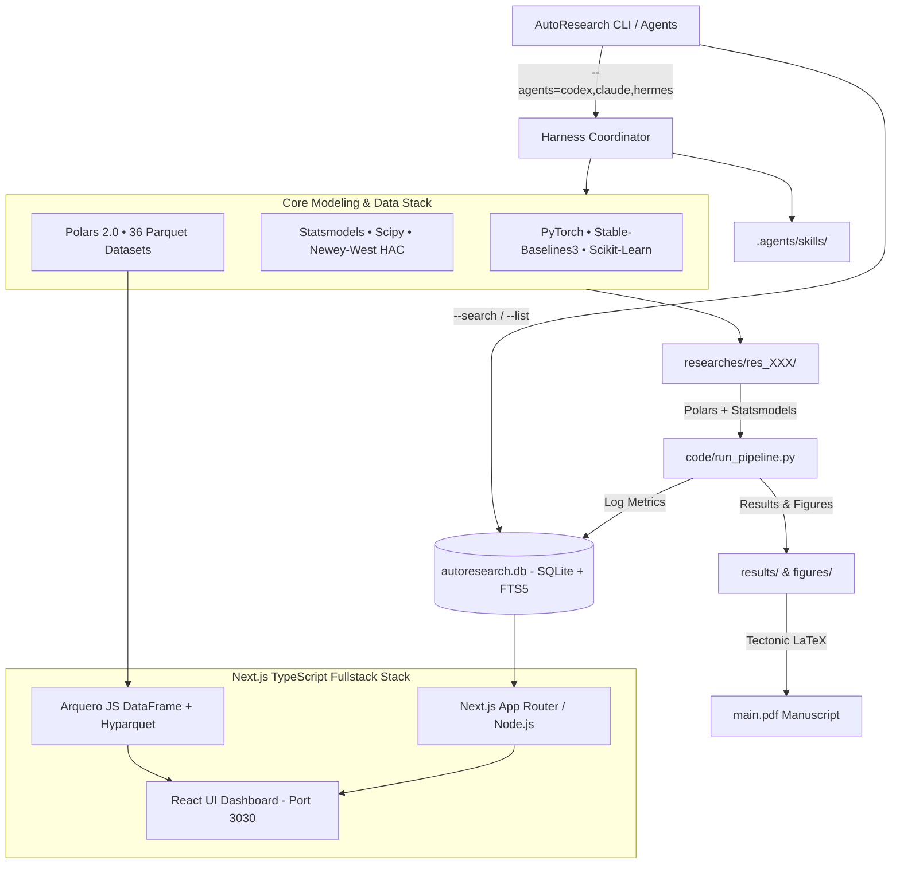

# hypoq — Autonomous AI Quantitative Research Lab & Empirical Modeling Harness

[](https://github.com/kimnt93/hypoq.git)
[](https://pytorch.org/)
[](https://www.statsmodels.org/)
[](https://nextjs.org/)
[](https://www.docker.com/)
[](https://tectonic-typesetting.github.io/)

**hypoq** is an institutional-grade autonomous AI quantitative research harness and data lake designed for financial economics, market microstructure, derivatives pricing, and macroeconomic spillovers.

The platform executes end-to-end hypothesis testing, combining **Machine Learning (`scikit-learn`)**, **Deep Learning (`pytorch`)**, and **Reinforcement Learning (`stable-baselines3`)** with rigorous econometrics (`statsmodels`, Newey--West HAC, ADF unit roots, placebo bootstrap tests) and zero-copy data processing (`polars`). Every study automatically serializes into a publication-ready LaTeX manuscript (`main.pdf`) and syncs empirical metrics to an indexed SQLite database with FTS5 BM25 deduplication.

---

## 🎬 Platform Overview & Live Dashboard


*Watch full resolution clip: [`assets/hypoq_demo.mp4`](assets/hypoq_demo.mp4)*

---

## 1. System Architecture



---

## 2. Standard Machine Learning & Econometric Stack

All empirical pipelines (`code/run_pipeline.py`) strictly utilize Python for research execution:

* **Machine Learning (`scikit-learn`)**: Expanding-window Purged TimeSeriesSplit cross-validation, HistGradientBoosting, Ridge/ElasticNet regularization, and factor return predictability.
* **Deep Learning (`pytorch`)**: Recurrent neural networks (LSTM), Temporal Convolutional Networks (TCN), and non-linear volatility regime nowcasting.
* **Reinforcement Learning (`stable-baselines3`)**: Deep Q-Learning (DQN) and Proximal Policy Optimization (PPO) agents operating on custom Gymnasium portfolio environments with transaction cost penalties.
* **Econometrics & Statistics (`statsmodels`, `scipy`)**: Heteroskedasticity and Autocorrelation Consistent (HAC) covariance with Bartlett kernel lag selection, Augmented Dickey-Fuller (ADF) stationarity, and 1,000-draw calendar placebo bootstrap tests.
* **High-Performance Data (`polars`)**: Zero-copy vectorized operations, lazy execution (`scan_parquet`), and strict Point-in-Time backward alignment (`join_asof(..., strategy="backward")`).

---

## 3. Quickstart & Deployment

### Run via Docker Compose (Recommended)
```bash
# Start Next.js Full Stack container on port 3030
make start

# View container health and logs
docker ps | grep hypoq-web
docker compose logs -f

# Stop the container stack
make stop
```

Access the interactive web dashboard at: **`http://localhost:3030`** (or `http://<server-ip>:3030`).

### Run via Multi-Agent CLI Harness
```bash
# Wake up concurrent AI research agents (Codex, Claude, Hermes)
python run.py --agents=codex,claude,hermes --topic="VN30 futures basis discount"

# Search historical hypotheses with FTS5 BM25 ranking to prevent duplicate runs
python run.py --search="order flow imbalance"

# List all recorded hypotheses and empirical decisions
python run.py --list
python run.py --list --status=ACCEPTED
```

---

## 4. Empirical Research Inventory

Every research project includes complete reproduction code, figures, empirical JSON metrics, and a compiled LaTeX manuscript:

| Study ID | Title | Methodology | Sample | Decision | Manuscript |
| :--- | :--- | :--- | :--- | :--- | :--- |
| **`res_001`** | Foreign Trading Flow and Price Impact | Newey--West HAC, Placebo Bootstrap | 2,031 sessions | **REJECTED** ($t = 1.67, p = 0.095$) | [`main.pdf`](researches/res_001_foreign_flow_impact/main.pdf) |
| **`res_002`** | Order Book Supply/Demand Imbalance | Queue Imbalance Ratio, OLS | 1,316 sessions | **ACCEPTED** ($t = 11.46, R^2 = 20.6\%$) | [`main.pdf`](researches/res_002_retail_order_flow_imbalance/main.pdf) |
| **`res_003`** | ETF NAV Premium-Discount Reversal | Error-Correction AR(1), Half-Life | 2,495 sessions | **ACCEPTED** (Half-life = 0.20 days) | [`main.pdf`](researches/res_003_etf_arbitrage_discount_reversal/main.pdf) |
| **`res_004`** | Interbank Monetary Liquidity Shocks | SBV Overnight Corridor Shocks | 2,264 sessions | **ACCEPTED** ($\beta = -0.078\%, t = -2.59$) | [`main.pdf`](researches/res_004_interbank_rate_equity_volatility/main.pdf) |
| **`res_005`** | VN30F1M Basis & Arbitrage Bands | Structural Discount & Half-Life | 2,284 sessions | **ACCEPTED** ($\mu = -20.07 \text{ bps}, t = -5.48$) | [`main.pdf`](researches/res_005_futures_basis_arbitrage_bands/main.pdf) |

---

## 5. Agent Skills Framework (`.agents/skills/`)

Modular skills following the [AgentSkills.io](https://agentskills.io) standard:

1. **`ml-dl-rl-modeling`**: Scikit-Learn, PyTorch, and Stable-Baselines3 empirical financial modeling pipelines.
2. **`hypothesis-testing-stats`**: Econometric testing protocols (ADF, HAC Newey--West, placebo resampling).
3. **`data-discovery`**: Auditing schemas, date ranges, and row counts across the 36 Parquet datasets.
4. **`data-explore-pit-builder`**: Constructing Point-in-Time (PIT) event datasets (Fed FOMC announcements, SBV rate changes).
5. **`data-exploration-js`**: Querying Parquet and SQLite using Arquero (JS pandas alternative) and `node:sqlite`.
6. **`polars-fast-data`**: Zero-copy expressions and backward `join_asof` alignment.
7. **`charts-visualization`**: Publication-grade Polars + Seaborn charts rendered strictly to high-DPI PNGs.
8. **`latex-report-generation`**: Compiling concise research reports via Tectonic using `templates/main.tex`.
9. **`arxiv-paper-search`**: Literature discovery via arXiv API and BibTeX extraction.
10. **`paper-pdf-to-md`**: Extracting equations and methodologies from research PDFs via `anymd`.
11. **`autoresearch-loop`**: Autonomous execution of the 8-stage AutoResearch cycle.
12. **`dedup-hypothesis-search`**: SQLite FTS5 BM25 deduplication matching.

---

## 6. Data Lake Architecture (`data/` - 36 Parquet Datasets)

* **`data/market/`**: Spot equities (`vn_top_equities_daily`), index OHLCV (`vn_indices_daily`), futures (`vn30f1m_derivatives_daily`), order supply/demand (`vn_order_supply_demand_daily`), foreign trading (`vn_foreign_trading_daily`), sector indices (`vn_sector_indices_daily`), and ETF market data (`vn_etf_market_daily`).
* **`data/market_structure/`**: Free-float factors (`free_float`), index constituents (`index_constituents`), corporate network directed edges (`vn_corporate_network_edges`), and nodes (`vn_corporate_network_nodes`).
* **`data/macro/`**: SBV monetary benchmarks (`vietnam_monetary_daily`), monthly macro indicators (`vietnam_macro_monthly`), domestic commodity prices (`vietnam_commodities_daily`), and US macro indicators (`us_macro_daily`).
* **`data/financials/`**: Corporate financial statements (`vn_financial_statements_quarterly_yearly`), standardized financial ratios (`vn_financial_ratios_quarterly_yearly`), and statutory circular taxonomy (`vn_financial_models_taxonomy`).
* **`data/cross_asset/`**: Global cross-asset benchmarks (`global_macro_daily`: S&P 500, US10Y, DXY, Gold, WTI crude, VIX, Bitcoin, USD/VND).

---

## 7. License & Attribution

Developed by the **AI Quantitative Research Network**. Released under the Apache 2.0 License.
