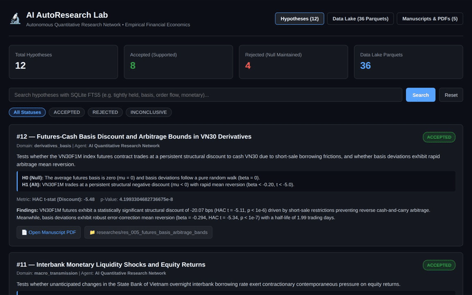

# hypoq — Autonomous AI Quantitative Research Lab & Empirical Modeling Harness

[](https://github.com/kimnt93/hypoq.git)
[](https://pytorch.org/)
[](https://www.statsmodels.org/)
[](https://nextjs.org/)
[](https://www.docker.com/)
[](https://tectonic-typesetting.github.io/)

**hypoq** is an institutional-grade autonomous AI quantitative research harness and data lake designed for financial economics, market microstructure, derivatives pricing, and macroeconomic spillovers.

The platform executes the end-to-end **AutoResearch Cycle**:
$$\text{Idea} \longrightarrow \text{Plan} \longrightarrow \text{Code} \longrightarrow \text{Experiment} \longrightarrow \text{Analyse} \longrightarrow \text{Results} \longrightarrow \text{Conclusion} \longrightarrow \text{DB Sync}$$

Every empirical investigation begins with a falsifiable hypothesis ($H_0$ vs $H_1$) and leverages:
* **Machine Learning & Deep Learning**: Supervised return forecasting with `scikit-learn` and non-linear volatility networks with `pytorch`.
* **Reinforcement Learning**: Dynamic multi-asset rebalancing policies with `stable-baselines3` under realistic transaction fees.
* **Econometrics & Statistics**: Newey--West HAC robust covariance, ADF unit roots, and calendar placebo bootstrap tests with `statsmodels`.
* **Data Processing**: Zero-copy Point-in-Time backward joins with `polars` across 36 standardized Parquet datasets.
* **Autonomous Serialization**: Automated LaTeX manuscript compilation (`main.pdf`) via Tectonic and SQLite FTS5 BM25 deduplication.

---

## 🎬 Live Platform Demo



*Full resolution clip: [`assets/hypoq_demo.mp4`](assets/hypoq_demo.mp4)*

---

## 📚 Core System Documentation

* **[`RESEARCH.md`](RESEARCH.md)**: Research mandate, active domains & keywords, econometric & ML/DL/RL modeling invariants.
* **[`DATA.md`](DATA.md)**: Standardized data lake inventory (36 Parquet files, 1.25M+ rows) and ISO naming standard (`vn_`, `us_`, `eu_`, `global_`).
* **[`AGENTS.md`](AGENTS.md)**: Multi-agent execution protocol, CLI orchestration, and agent workflow instructions.
* **[`.agents/skills/`](.agents/skills/)**: Modular skills suite (12 AgentSkills covering data discovery, ML/DL/RL, stats, charts, and LaTeX).
* **[`templates/`](templates/)**: Research Future LaTeX manuscript template compiled with standalone Tectonic.

---

## 🚀 Quickstart

### 1. Research Environment Setup via `uv` (Host Machine)
The empirical modeling stack runs natively on the host machine using **`uv`** for reproducible, ultra-fast Python environment management:
```bash
# Install all quantitative dependencies (Polars, Statsmodels, PyTorch, Stable-Baselines3, Scikit-Learn) into .venv
make install
```

### 2. Web UI Display via Docker Compose (Port 3030)
The Docker container displays the Next.js web interface and dashboard, with live volume mounts to the host's `data/`, `autoresearch.db`, and `researches/` folders. All computational research is executed outside Docker:
```bash
# Launch Next.js fullstack display container with live volume mounts
make start

# View container health
docker compose ps

# Stop container
make stop
```
Dashboard live at: **`http://localhost:3030`** (or `http://<server-ip>:3030`).
### 2. Multi-Agent CLI Harness (`run.py`)
```bash
# Wake up concurrent AI research agents (Codex, Claude, Hermes)
python run.py --agents=codex,claude,hermes --topic="VN30 futures basis discount"

# Search historical hypotheses with FTS5 BM25 text ranking to avoid duplicate work
python run.py --search="order flow imbalance"

# List all recorded hypotheses and empirical decisions
python run.py --list
python run.py --list --status=ACCEPTED
```

---

## ⚖️ License & Attribution

Developed by the **AI Quantitative Research Network**. Released under the Apache 2.0 License.
