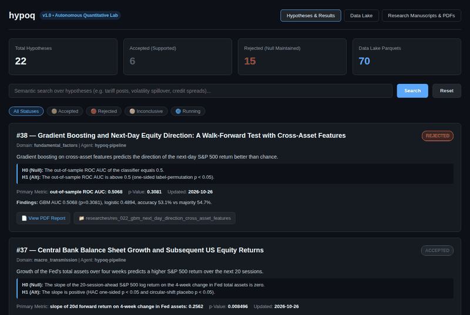
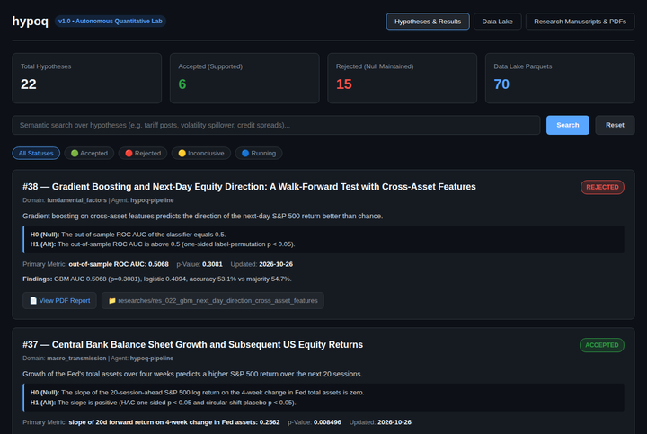
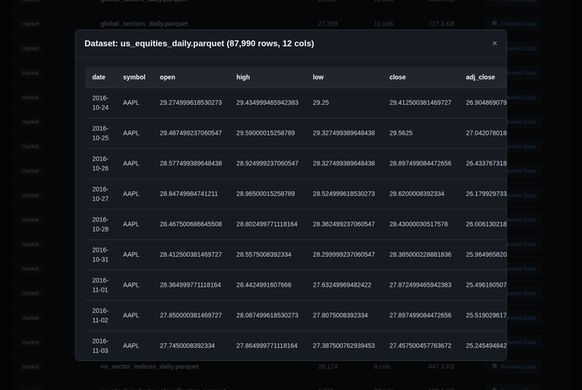
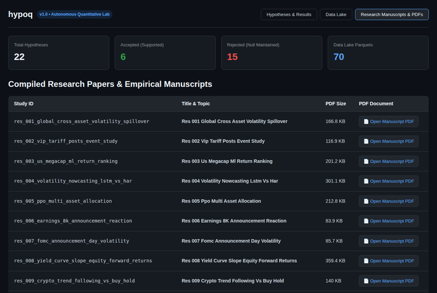
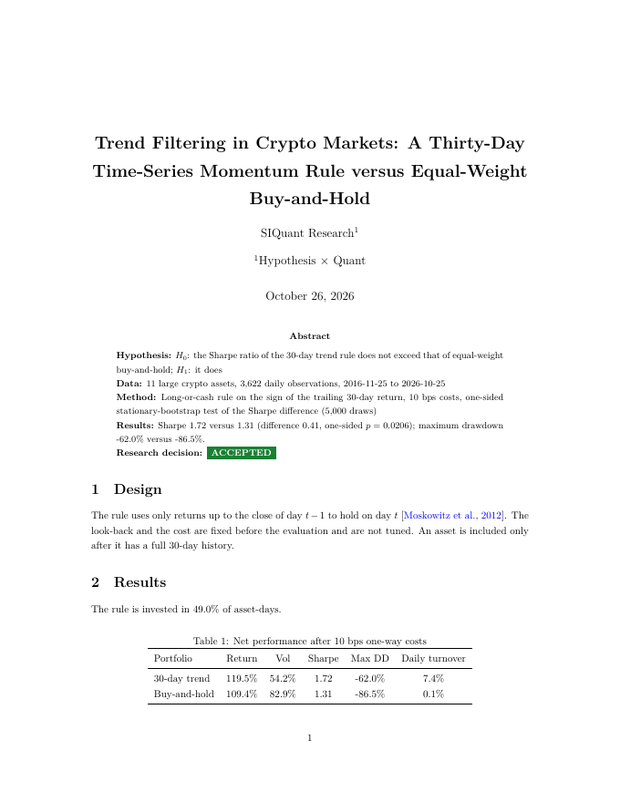

# hypoq (Hypothesis × Quant) — A Harness for Autonomous AI Quantitative Research

> **hypoq** is a harness that lets AI coding agents (Claude, Codex, Hermes, Pi, OMP) run falsifiable quantitative research on a **free, real, point-in-time-aware data lake**, and then *proves* that what they report is what they computed.

[](https://github.com/kimnt93/hypoq.git)
[](https://pytorch.org/)
[](https://www.statsmodels.org/)
[](https://www.docker.com/)
[](LICENSE)
[](https://tectonic-typesetting.github.io/)

<p align="center"></p>

<table>
<tr>
<td align="center" width="25%"><br><sub>Hypotheses and results</sub></td>
<td align="center" width="25%"><br><sub>Data lake preview</sub></td>
<td align="center" width="25%"><br><sub>Compiled manuscripts</sub></td>
<td align="center" width="25%"><br><sub>Generated paper (author, decision badge)</sub></td>
</tr>
</table>

---

## Why this exists

Autonomous research agents are fast and fluent, which makes it easy for them to produce convincing but unfounded results (typed-in numbers, simulated data, decisions chosen to look good).
hypoq makes that structurally hard:

1. **Real data only.** `data/` holds 70 Parquet files (3.1M rows) downloaded from free, key-less public sources. Nothing is simulated, hand-typed, interpolated or zero-filled. Paid or login-only sources are excluded.
2. **Numbers are computed, never typed.** Each study is a script (`researches/<id>/code/run_pipeline.py`) that writes its tables, figures, paper and database row from the same results dictionary (`hypoq.pipeline.finalize`).
3. **Decisions come from the test.** `ACCEPTED` means the pre-registered test supports $H_1$, `REJECTED` that it does not. Null results are published as such.
4. **An audit gate.** `python run.py --audit` fails any study without code, without a PDF, or whose JSON, paper and database status disagree.
5. **A deduplication memory.** Every hypothesis is stored with a dense embedding so agents see what was already tested before they start. The database itself is not versioned: it is rebuilt from the raw study records (see [Database](#database-records-embeddings-and-migration)).

```text
Idea ─► Dedup ─► Plan ─► Code ─► Experiment ─► Analyse ─► Report (LaTeX/PDF) ─► DB sync ─► Audit
```

**Division of labour.** The `hypoq/` package is frozen: it only discovers (`--search`, `--list`), saves (`finalize`, `upsert_hypothesis`) and loads hypotheses, and audits them. A research task never edits it. Everything a study needs lives in `researches/<id>/` (its own pipeline code, including any metric or test it needs) and in the **skills** under `.agents/skills/`, which tell an agent which data exist, which methods and metrics to use, and how to write a missing one correctly with Polars and NumPy.

---

## Quick start

```bash
cp .env.example .env               # optional: database, embeddings, ports, SEC contact (make and docker compose read it)
make install                       # uv sync, verify the stack, import the example studies into the local database (+ embeddings), start the dashboard container
python run.py --list               # what has been tested so far
python run.py --search "tariff announcements and equity volatility"   # semantic dedup
make verify                        # data-quality audit of every Parquet file
make audit                         # research integrity audit
make test                          # unit tests
make api                           # JSON API + dashboard on http://127.0.0.1:8080
```

### Launch agents

```bash
# 1) Dry run: writes one protocol prompt per agent under runs/<session>/
python run.py --agents=claude,hermes --topic="Euro area credit spread shocks and bank equity returns"

# 2) Real run: launches the agent CLIs in parallel in this checkout, logs them, then audits what they produced
python run.py --agents=claude,hermes --topic="..." --execute
```

The prompt tells each agent the protocol, the integrity rules, the overlapping prior hypotheses (with status, metric and similarity) and every available dataset.
Agent commands are defined in `hypoq/harness.py` (`DEFAULT_AGENT_COMMANDS`) and can be overridden per agent with `HYPOQ_AGENT_CMD_<NAME>` (placeholders `{prompt_file}` and `{root}`).

| Agent | Default command | Status |
| :--- | :--- | :--- |
| `claude` | `claude -p … --permission-mode acceptEdits --allowedTools "Bash Edit Write Read Glob Grep"` | verified end to end |
| `hermes` | `hermes -z … --yolo` | verified end to end |
| `codex` | `codex exec -s workspace-write -C <repo> …` | flags match `--help`; needs a valid login |
| `omp` | `omp -p … --approval-mode=yolo` | flags match `--help`; needs a valid login |
| `pi` | `pi -p …` | flags match `--help`; needs a valid login |

> **Security**: agents run unsandboxed on the host with shell access. Use the harness only in a trusted checkout (or a container/VM).

---

## Studies produced with the harness

Every number below is computed by the study's own `run_pipeline.py`; re-run them all with `make seed`.

<!-- STUDIES:START -->
| ID | Domain | Paradigm | Status | Test statistic (p-value) | Title |
| :--- | :--- | :--- | :---: | :--- | :--- |
| [`001`](researches/res_001_global_cross_asset_volatility_spillover) | Macro transmission | Econometrics | **REJECTED** | HAC t-stat (Nikkei) = 7.7 (p = 6.8e-15) | Cross-Border Return Transmission from the US Session to European and Japanese Equity Markets |
| [`002`](researches/res_002_vip_tariff_posts_event_study) | Sentiment / events | Event study | **REJECTED** | min placebo p = 0.0696 (p = 0.0696) | Tariff-Related Executive Social Media Posts and Next-Day US Equity and Implied Volatility Reactions |
| [`003`](researches/res_003_us_megacap_ml_return_ranking) | Factors / allocation | Machine learning | **ACCEPTED** | GBM mean rank IC = 0.0133 (p = 0.0363) | Gradient-Boosted Ranking of Next-Week Returns in US Mega-Cap Equities: A Walk-Forward Test |
| [`004`](researches/res_004_volatility_nowcasting_lstm_vs_har) | Macro transmission | Deep learning | **INCONCLUSIVE** | DM t-stat (best asset) = 3.76 (p = 8.4e-05) | Recurrent Neural Networks versus HAR for Five-Day-Ahead Volatility Forecasts of Equities and Bitcoin |
| [`005`](researches/res_005_ppo_multi_asset_allocation) | Factors / allocation | Reinforcement learning | **REJECTED** | Sharpe difference vs equal weight = -0.993 (p = 1) | Proximal Policy Optimisation for Multi-Asset ETF Allocation under Transaction Costs |
| [`006`](researches/res_006_earnings_8k_announcement_reaction) | Sentiment / events | Event study | **ACCEPTED** | mean \|CAR[0,+1]\| = 0.0459 (p = 2.0e-04) | Earnings Filings and Price Reactions: An Event Study of SEC 8-K Item 2.02 Announcements for US Mega-Caps |
| [`007`](researches/res_007_fomc_announcement_day_volatility) | Macro transmission | Event study | **REJECTED** | mean \|S&P 500 return\| on FOMC days = 0.00846 (p = 0.102) | Federal Reserve Announcement Days and US Equity Volatility: An Event Study of FOMC Statements, 2016--2026 |
| [`008`](researches/res_008_yield_curve_slope_equity_forward_returns) | Macro transmission | Predictive regression | **REJECTED** | slope of 126d forward return on 10y-3m spread = -0.0262 (p = 0.966) | Does the Slope of the US Yield Curve Predict Six-Month-Ahead US Equity Returns? A Predictive Regression with Overlap-Robust Inference |
| [`009`](researches/res_009_crypto_trend_following_vs_buy_hold) | Crypto | Rule-based strategy | **ACCEPTED** | annualised Sharpe difference (trend minus buy-and-hold) = 0.41 (p = 0.0206) | Trend Filtering in Crypto Markets: A Thirty-Day Time-Series Momentum Rule versus Equal-Weight Buy-and-Hold |
| [`010`](researches/res_010_vn_foreign_flows_next_day_index_return) | Market microstructure | Predictive regression | **REJECTED** | beta of next-day VN-Index return on foreign flow imbalance = 9.6e-04 (p = 0.307) | Foreign Investor Order Flow and Next-Day Returns on the Vietnamese Equity Market |
| [`011`](researches/res_011_global_low_volatility_anomaly) | Factors / allocation | Cross-sectional sort | **REJECTED** | annualised Sharpe difference (Q1 minus Q5) = 0.235 (p = 0.289) | The Low-Volatility Anomaly in a Pooled Universe of Large-Cap Equities from Seven Regions |
| [`012`](researches/res_012_vn30_futures_basis_next_day_spot_return) | Market microstructure | Predictive regression | **REJECTED** | beta of next-day VN30 return on futures basis = 0.0319 (p = 0.292) | Futures Basis and Next-Day Spot Returns on the Vietnamese VN30 Index |
| [`013`](researches/res_013_vix_zscore_next_week_equity_return) | Macro transmission | Predictive regression | **REJECTED** | slope of 5d forward return on VIX z-score = -2.3e-04 (p = 0.607) | Fear Spikes and Next-Week Returns: Does an Elevated VIX Predict Higher US Equity Returns? |
| [`014`](researches/res_014_safe_haven_gold_treasuries_bitcoin) | Macro transmission | Safe-haven test | **ACCEPTED** | mean return of TLT on worst-decile S&P days = 0.00254 (p = 0.0108) | Safe Havens in Equity Crashes: Gold, Long Treasuries and Bitcoin on the Worst US Equity Days |
| [`015`](researches/res_015_credit_risk_appetite_lead_equities) | Macro transmission | Predictive regression | **REJECTED** | slope of next-5d SPY return on 5d HYG-IEF return = -0.0761 (p = 0.703) | Does High-Yield Credit Lead Equities? Relative Bond Performance and Next-Week Stock Returns |
| [`016`](researches/res_016_turn_of_month_effect_sp500) | Factors / allocation | Calendar effect | **REJECTED** | mean daily return on turn-of-month sessions = 6.9e-04 (p = 0.39) | The Turn-of-the-Month Effect in the US Stock Index, 2016--2026 |
| [`017`](researches/res_017_overnight_vs_intraday_returns_us_equities) | Market microstructure | Return decomposition | **REJECTED** | mean overnight minus intraday daily return = 3.6e-04 (p = 0.0604) | Overnight versus Intraday Returns of US Mega-Cap Stocks |
| [`018`](researches/res_018_global_momentum_winners_minus_losers) | Factors / allocation | Cross-sectional sort | **REJECTED** | annualised Sharpe difference (winners minus losers) = 0.329 (p = 0.151) | Twelve-Minus-One Month Momentum in a Pooled Universe of Large-Cap Equities from Seven Regions |
| [`019`](researches/res_019_vn_market_pe_forward_return) | Factors / allocation | Predictive regression | **ACCEPTED** | slope of 252d forward return on P/E = -0.0541 (p = 6.3e-04) | Valuation and Subsequent Returns in Vietnam: Does a Low Market P/E Predict Higher One-Year VN-Index Returns? |
| [`020`](researches/res_020_crypto_day_of_week_effect) | Crypto | Calendar effect | **REJECTED** | HAC Wald chi-square (6 df) for equal weekday means = 10.7 (p = 0.0983) | Day-of-the-Week Effects in Cryptocurrency Returns |
| [`021`](researches/res_021_fed_balance_sheet_growth_equity_returns) | Macro transmission | Predictive regression | **ACCEPTED** | slope of 20d forward return on 4-week change in Fed assets = 0.256 (p = 0.0085) | Central Bank Balance Sheet Growth and Subsequent US Equity Returns |
| [`022`](researches/res_022_gbm_next_day_direction_cross_asset_features) | Factors / allocation | Machine learning | **REJECTED** | out-of-sample ROC AUC = 0.507 (p = 0.308) | Gradient Boosting and Next-Day Equity Direction: A Walk-Forward Test with Cross-Asset Features |
<!-- STUDIES:END -->

`ACCEPTED` = the pre-registered test supports $H_1$; `REJECTED` = it does not; `INCONCLUSIVE` = the evidence is mixed across the pre-specified tests. Study 001 is rejected because its Europe leg fails the Bonferroni threshold, and study 004 is inconclusive because the LSTM beats HAR for Bitcoin but not for the S&P 500.

Most studies are null results, which is the expected outcome for well-known ideas on a free data lake with a short sample: FOMC-day volatility, the yield-curve slope (opposite sign in 2016-2026), the VIX z-score, credit leading equities, the turn-of-month effect, momentum and low-volatility sorts, VN foreign flows and futures basis, crypto weekdays and gradient-boosted next-day direction (AUC 0.507) are all not supported. The accepted studies differ in strength: 006 (earnings filings move prices) is strong and mechanical; 014 finds that long Treasuries, but not gold or Bitcoin, earned a positive return on the worst S&P 500 days; 019 (low VN-Index P/E predicts higher one-year returns) rests on about eight independent years; 021 (Fed balance-sheet growth) loses significance when 2020 is excluded (the paper reports this); 003 and 009 are accepted at $p$ between 0.02 and 0.04 in survivorship-biased universes. Read them as leads, not tradable edges. The table is regenerated from the database by `python .agents/skills/hypoq-loop/scripts/update_study_table.py`, so no number in it is typed by hand.

---

## Data lake

70 Parquet files across Asia, the United States, Europe, crypto, Vietnam and raw community text. Full schemas, provenance, refresh mode and caveats are in **[`DATA.md`](DATA.md)**.

| Folder | Content | Source |
| :--- | :--- | :--- |
| `data/market/` | Indices, mega-cap equities and ETFs for US, EU, JP, KR, HK, CN, Asia aggregates; sector, factor and Vietnamese market data | Yahoo Finance, VNDirect |
| `data/macro/` | Yield curve, Fed balance sheet, FOMC decisions, credit spreads, volatility indices, commodities, FX, Vietnamese macro | FRED, Yahoo Finance, FOMC statements, WiData snapshot |
| `data/crypto/` | Top crypto assets and BTC/ETH aggregate indicators | Yahoo Finance |
| `data/community/` | Truth Social posts, Fed statements and speeches, SEC 8-K filings, Hacker News, Stack Exchange, Mastodon (raw text, no sentiment) | public APIs |
| `data/financials/` | Global fundamentals snapshot, Vietnamese statements and ratios | Yahoo Finance, VNDirect |
| `data/market_structure/` | Vietnamese free float, baskets, ownership and corporate networks | exchange notices (snapshot), VNDirect |
| `data/cross_asset/` | Cross-asset daily panel | Yahoo Finance |

Refresh everything live with `make download` (about ten minutes), then `python scripts/update_data_docs.py` to resync the numbers in `DATA.md`.
Two environment variables matter: `HYPOQ_CONTACT` (your own email, required politely by SEC EDGAR's fair-access policy) and `HYPOQ_VN_STRUCTURE_DIR` (location of the Vietnamese index-structure CSV snapshot).

**Deliberately excluded**: Reddit and X (an account is required), paid fundamentals and consensus estimates, ETF NAV/AUM, and any synthetic series.

**Point-in-time warnings** that agents must respect: Yahoo equity universes are today's large caps (survivorship bias); company fundamentals snapshots are as of the download date; Vietnamese statements carry no publication date and mix actuals with analyst estimates; many macro series are dated at the end of their reference period and published later. See `DATA.md` §1.2.

---

## Architecture

```text
┌────────────────────────────────────────────────────────────────────────┐
│ HOST (native research engine)                                          │
│ • scripts/download_all.py  -> data/*.parquet (free public sources)     │
│ • run.py / hypoq/harness.py -> prompts, agent launch, audit            │
│ • researches/*/code/run_pipeline.py -> results, figures, main.pdf      │
│ • hypoq/db.py -> SQLite (hypoq.db, git-ignored) or PostgreSQL          │
│   rebuilt from researches/*/results/hypothesis_record.json (db-import) │
│ • api.py -> JSON API + dashboard (read-only, localhost by default)     │
└───────────────────────────────────┬────────────────────────────────────┘
                                    │ volume mounts (./data, ./hypoq.db, ./researches)
┌───────────────────────────────────▼────────────────────────────────────┐
│ DOCKER (Next.js dashboard, port 3030): hypothesis cards, PDFs, datasets│
└────────────────────────────────────────────────────────────────────────┘
```

| Path | Purpose |
| :--- | :--- |
| `hypoq/` | **Frozen** discover / save / load layer: `db.py` (dual backend, embeddings, `upsert_hypothesis`), `harness.py` (sessions, prompts, `audit_research`), `pipeline.py` (`finalize`), `report.py` (LaTeX), `embeddings.py` |
| `scripts/` | Ingestion (`ingest_*.py`, `yf_common.py`, `vnd_common.py`), `verify_datasets.py`, `update_data_docs.py`, `seed_database.py` |
| `researches/` | One self-contained folder per study: `code/` (all study logic), `results/`, `figures/`, `main.tex`, `main.pdf`, `references.bib` |
| `.agents/skills/` | 18 AgentSkills (data exploration, event studies, ML/DL/RL, PIT construction, LaTeX, dedup, the hypoq loop). `hypothesis-testing-stats/scripts/quant_metrics.py` is a tested reference library of metrics and tests to copy from |
| `.env.example` | Every supported environment variable with its default |
| `templates/` | LaTeX template |
| `web/`, `Dockerfile`, `docker-compose.yml` | Next.js dashboard and PostgreSQL option |
| `tests/` | pytest suite (database, audit, harness, API security, data quality) |

### Database: records, embeddings and migration

`hypoq.db` (SQLite) is a local, **git-ignored** file. What is versioned is the *raw record* of each study, `researches/<id>/results/hypothesis_record.json`: hypothesis metadata plus the computed results, with no vectors, ids or timestamps. `hypoq.pipeline.finalize` writes it every time a pipeline runs.

```bash
make db-import     # load every record into the database (insert or update by title) and create the embeddings; part of `make install`
make db-migrate    # re-embed after changing EMBEDDING_PROVIDER / EMBEDDING_MODEL / GEMINI_API_KEY (FORCE=1 recomputes everything)
make db-export     # back-fill records from an existing database
```

Vectors are created at import time with the active method and stored with its id (for example `huggingface:sentence-transformers/all-MiniLM-L6-v2` or `gemini:text-embedding-004`). If you change the method, `make db-migrate` recomputes every vector whose id differs, from the hypothesis text already stored, so no study has to be re-run; `python run.py --search` also migrates on demand. An embedding method that cannot load raises an error: hypoq never substitutes a vector from another model. For PostgreSQL set `DATABASE_URL` (or run `make install-pg`); the same import runs against it.

### Dashboard / API

```bash
make api                 # python run.py --web  -> http://127.0.0.1:8080  (set HYPOQ_HOST to expose it)
make install-sqlite      # Next.js dashboard in Docker on http://localhost:3030
make install-pg          # same, with PostgreSQL + pgvector
```

Endpoints (`api.py`): `/api/hypotheses?q=&status=`, `/api/datasets`, `/api/dataset_preview?path=`, `/api/reports`, `/pdf?path=`. File endpoints are restricted to `data/*.parquet` and `researches/**/*.pdf`.

---

## Writing a new study by hand

```bash
mkdir -p researches/res_NNN_<slug>/{code,figures,results}
# copy a reference study as a starting point (res_003 ML, res_004 DL, res_005 RL, res_006/res_007 event study,
# res_008/res_010/res_012 predictive regression, res_009/res_011 strategy and portfolio tests),
# copy the metrics you need from .agents/skills/hypothesis-testing-stats/scripts/quant_metrics.py (or write your own),
# change the data, the test and the decision rule. Do not edit hypoq/, scripts/ or api.py. Then:
python researches/res_NNN_<slug>/code/run_pipeline.py
python run.py --audit
```

`finalize(...)` writes `results/empirical_results.json`, `main.tex`, `references.bib`, compiles `main.pdf` with Tectonic and registers the hypothesis and experiment idempotently.

---

## Command reference

```bash
make install   make download   make verify   make audit   make seed   make test   make api
make db-import   make db-migrate [FORCE=1]   make db-export
make install-pg   make install-sqlite   make start   make stop   make parse-doc FILE=<path>   make clean
python run.py --agents=<a,b> --topic="…" [--execute]   python run.py --audit   python run.py --search "…"   python run.py --list [--status=ACCEPTED]
```

## Limitations

- The studies are small reference implementations, not investment advice: universes are survivorship-biased, test windows are short, transaction costs are crude.
- Agent CLIs other than `claude` and `hermes` were not verified end to end on the author's machine (expired logins).
- Vietnamese macro and index-structure tables are dated snapshots (see `DATA.md` §1.2), not live downloads.
- The harness cannot stop an agent from writing a dishonest *pipeline*; the audit checks structure and consistency, so review the code of studies you rely on.

## License

MIT, see [`LICENSE`](LICENSE).
